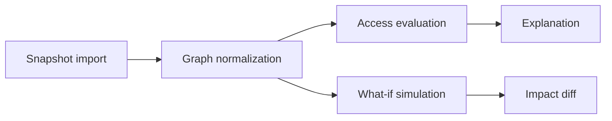

# PermitGraph

**Explainable permissions and access-change simulation.** PermitGraph shows exactly why someone has access to a resource, and previews who would lose access if you changed a grant or group membership, without touching the source system.

> **Status:** early development, following a 5-week roadmap (see below). It works on synthetic snapshots; any live connector will be optional and read-only.

## The problem

An administrator wants to remove a broad grant but doesn't know who relies on it. Access is inherited through nested groups and overlapping grants, so it's hard to answer:

- why does this person have write access?
- if I remove this membership, who actually loses access?
- where is access kept by another grant anyway?

PermitGraph answers these with a visible access graph and before/after simulations.

## Demo workflow

1. Trace a contractor's write access through a nested group
2. Simulate removing that group membership
3. See one repository where write access disappears
4. See another where an alternate grant keeps it
5. See an unsupported policy return UNKNOWN instead of a guess

## Planned features

- Import of immutable synthetic snapshots: identities, groups, repositories and grants
- Effective-access explanations through visible inheritance paths
- ALLOW, DENY or UNKNOWN results under a documented subset of policy rules
- Before/after comparison of a simulated change, including access kept through other grants
- Broad-grant findings with evidence and stated assumptions
- Optional read-only GitHub connector

## Tech stack

| Layer | Technology |
|---|---|
| Frontend | Next.js, TypeScript |
| API | Fastify |
| Graph evaluation | Standalone graph evaluator package |
| Database | PostgreSQL, Prisma |
| Validation | Zod |
| Testing | Vitest, Playwright |
| Packaging | Docker |

## Architecture



**Core entities:** Snapshot, Principal, Group, MembershipEdge, Resource, Grant, PolicyStatement, EvaluationResult, ChangeProposal, ImpactRecord.

## Design rules

- Snapshots are immutable. Simulations never modify the source system.
- UNKNOWN is a real answer: unsupported or incomplete policy data never becomes ALLOW or DENY.
- Every finding links to the rule and assumptions behind it.
- Graph traversal is bounded, and cycles or oversized imports fail predictably.
- Workspaces never share graph data.

## Roadmap

| Week | Focus | Status |
|---|---|---|
| Week 1 | **W01-01 + foundation** — Scaffold workspace with standalone evaluator package, evaluate direct membership with fixture tests, add Fastify API with Prisma schema for workspaces and roles, add immutable snapshots and synthetic seed | ✅ Done |
| Week 2 | **Graph** — Normalize nodes and edges, validate graph imports, add graph search, add graph explorer, add access-path inspector | Planned |
| Week 3 | **Policy** — Add allow, deny and unknown precedence, add change proposals with dry-run evaluation, show before/after diffs | Planned |
| Week 4 | **Findings & conformance** — Flag broad grants with evidence, bound traversal and handle cycles and oversized imports | Planned |
| Week 5 | **Release** — Benchmark larger graphs, package containers and document operations, add end-to-end tests and API docs | Planned |

## Getting started

The repository is a pnpm workspace (Node 22, see `.nvmrc`):

| Package | Contents |
|---|---|
| [`packages/evaluator`](packages/evaluator/README.md) | Standalone graph evaluator, no I/O |
| [`apps/api`](apps/api/README.md) | Fastify API with Prisma: workspaces, roles, immutable snapshots, synthetic seed |

```sh
pnpm install
pnpm lint && pnpm typecheck && pnpm test
docker compose up -d postgres   # local PostgreSQL for the API, see apps/api/README.md
```
